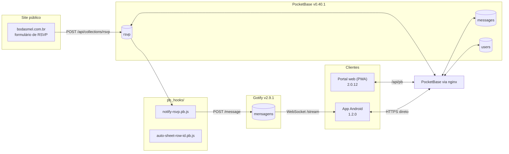

<div align="center">

# Portal Admin — Bodas de Esmeralda M&L

**Console de operação do evento: lista de convidados, mural de mensagens e exportação.**

[](https://portal.bodasmel.com.br)
[](https://github.com/llopes-86/new-admin-portal/releases/tag/apk/v1.2.0)
[](#)
[](#)
[](#)

</div>

---

## TL;DR

Este repositório tem **duas interfaces para a mesma operação**:

| | Portal web (PWA) | App Android (nativo) |
|---|---|---|
| **Versão** | `2.0.12` — HTML/CSS/JS puro, sem build | `1.2.0` — Kotlin + Jetpack Compose |
| **Onde roda** | navegador (desktop ou celular) | celular Android (sideload) |
| **Notificação push** | ❌ não tem | ✅ Gotify via WebSocket, com o app fechado |
| **Exportar** | XLSX + PDF no navegador | XLSX + PDF salvos em **Downloads** |
| **Identidade visual** | fonte da verdade (cores, fontes, layout) | espelho fiel do portal |

O **portal web continua no ar** sem alteração: o app foi construído **em cima** dele, não no lugar dele.

---

## 📖 A ideia: como chegamos do PWA ao app Android nativo

### 1. O portal nasceu como PWA — mas a PWA não avisa nada

A primeira versão do portal já era instalável (`manifest.json` + `sw.js` + `offline.html`), para a equipe
abrir pelo ícone na tela inicial, sem digitar endereço. Só que o `sw.js` fazia **apenas cache do shell**:

```js
// public/sw.js — o que existe hoje
const CACHE = 'bodas-admin-v2.0.12';
const SHELL = ['/', '/css/admin.css', /* ... */];
```

**Não existe nenhum handler de `push` no service worker.** Consequência prática: mesmo com o portal
instalado, **ninguém era avisado** quando um RSVP novo caía — era preciso alguém abrir o app (ou a
aba) para olhar.

### 2. Do outro lado, o caminho do push já existia (e estava quebrado)

Na infraestrutura já havia um **Gotify** rodando e um hook do PocketBase que mandava cada RSVP novo
para lá:

```js
// pb_hooks/notify-rsvp.pb.js — hoje já corrigido
$http.send({
  url: url + "/message",
  method: "POST",
  headers: { "X-Gotify-Key": token },
  body: JSON.stringify({ title: "Novo RSVP", message: msg.join("\n"), priority: 5 })
});
```

Só que esse hook usava `onRecordAfterCreateRequest` — **hook que não existe no PocketBase v0.40**
(o renomeado é `onRecordAfterCreateSuccess`). Com o nome antigo o arquivo **falha ao carregar** e
**nenhuma notificação saía**. Foi a auditoria que revelou isso (ver `APK/stack.md` §5).

### 3. A conclusão que virou projeto

> O caminho do push estava pronto até o penúltimo metro:
> `site → PocketBase → Gotify`. Faltava só o **último trecho**: um cliente que recebesse a
> mensagem **com o aplicativo fechado**.

Duas decisões foram fechadas com o usuário:

| Decisão | Por quê |
|---|---|
| **Reescrever 100% nativo em Kotlin/Compose** (não embrulhar a web num WebView) | notificação real, foreground service, export para Downloads, e nada de "app que é um site"; a API já é só `GET/POST/PATCH` no PocketBase, então o cliente HTTP próprio é simples |
| **Reaproveitar o Gotify em vez de trazer FCM/Firebase** | o servidor já tinha push pronto; FCM exigiria conta de desenvolvedor Google, e o app é distribuído por sideload (sem Play Store) |

E uma regra importante: **o portal web não foi tocado**. O app é novo, em `APK/`, e o que está em
produção continua exatamente como estava (risco zero de regressão).

### 4. Como o app resolve o que a PWA não resolvia

```
Site de RSVP (bodasmel.com.br)
        │  POST /api/collections/rsvp
        ▼
   PocketBase  ──hook onRecordAfterCreateSuccess──▶  Gotify  ──WebSocket /stream──▶  App Android
   (rsvp)                                          (POST /message)                   (Foreground Service)
```

- O **Gotify** é o mensageiro (já existia na stack; só o hook precisou ser consertado).
- O **app** conecta no `/stream` do Gotify via **WebSocket** (o Gotify não usa SSE) com um
  *client token* criado pelo próprio aparelho, e mantém a conexão viva num **Foreground Service**
  (`foregroundServiceType="specialUse"`, sem o limite de 6 h/dia do `dataSync` no Android 15+).
- Ao chegar mensagem nova, o app mostra uma **notificação** que, ao ser tocada, **abre direto na
  aba de convidados** — e a lista recarrega sozinha.

### 5. E o que mais mudou além do push

O app não é "só push": ele **espelha o portal inteiro** — login (com troca obrigatória de senha),
Convidados, Mural, Exportar, Ajustes e tema claro/escuro — com **paridade visual de 1:1**
(mesmas fontes Inter/Playfair Display, mesmas cores, mesmo card de convidado, mesmo rodapé com a
data e o badge de status).

### Linha do tempo

| Data | Marco |
|---|---|
| 2026-10-21 | Auditoria do stack (`APK/stack.md`), toolchain Android instalado, keystore de release criado |
| 2026-10-22 | **v1.0.0** — app completo (F0→F8), hook do PocketBase corrigido e validado contra o PocketBase v0.40.1 |
| 2026-10-22 | **v1.1.0** — UX alinhada ao portal (login igual ao web, lembrar-me, swipe no mural) |
| 2026-10-22 | **v1.2.0** — paridade total: fontes do site no app, card igual ao portal, data corrigida, busca/filtros roláveis, notificações compactas |

---

## 🏗️ Arquitetura



- O **PocketBase** é a única fonte de verdade (`users`, `rsvp`, `messages`).
- O **nginx** (`admin-portal_nginx.conf`) faz proxy de `/api/pb` → PocketBase e serve o portal com
  CSP estrita, `no-store` nos dados sensíveis, `limit_req 60r/m` e allowlist de métodos
  (`GET/POST/PATCH`).
- O **app** fala direto com o PocketBase por HTTPS (sem CORS, que é problema de browser) e com o
  Gotify por WebSocket.

---

## 📂 Mapa do repositório

```
New-Admin-Portal/
├── public/                  # ▸ Portal web (PWA) — HTML/CSS/JS puro, sem build step
│   ├── index.html           #   login + troca de senha
│   ├── dashboard.html       #   shell do painel (sidebar desktop / bottom-nav mobile)
│   ├── css/                 #   base/ + components/ (mesma paleta e fontes do app)
│   ├── js/                  #   features/ (convidados, mural, export), utils/, api/
│   ├── lib/                 #   pocketbase.umd.js, xlsx, jspdf, fontes woff2
│   ├── manifest.json        #   PWA
│   ├── sw.js                #   service worker (cache do shell — sem push)
│   └── offline.html
├── APK/                     # ▸ App Android nativo (Kotlin + Compose)
│   ├── app/src/main/java/com/bodasmel/adminml/
│   │   ├── core/            #   Format (datas), SecureStore, SessionManager, Settings
│   │   ├── data/            #   PocketBaseClient, stores de convidados e mural
│   │   ├── domain/          #   filtros e parse (paridade com o portal)
│   │   ├── push/            #   GotifyClient, GotifyService, Notifications
│   │   ├── theme/           #   paleta, tipografia e fontes do portal
│   │   └── ui/              #   login, home, guests, messages, export, settings, components
│   ├── app/src/main/res/font/   # Inter + Playfair Display (mesmos glifos do site)
│   ├── app/src/test/        #   32 testes (Robolectric)
│   ├── CHANGELOG.md
│   ├── stack.md             #   ★ mapa técnico completo do projeto
│   └── README.md            #   guia de instalação e operação do app
├── pb_hooks/                # ▸ Hooks do PocketBase (notificar Gotify + sheet_row_id)
├── tools/                   # ▸ bump-version.ps1 (web) e bump-app-version.ps1 (app)
├── pb_schema.json           #   dump do schema do PocketBase
├── admin-portal_nginx.conf  #   nginx de produção
├── PRODUCT.md               #   visão de produto, usuários e princípios
└── AGENTS.md / CLAUDE.md    #   instruções para agentes de código
```

---

## 🌐 O portal web (2.0.12)

PWA instalável, sem build step (é HTML/CSS/JS servido como estático).

- **Login** e-mail + senha, com troca obrigatória de senha (`must_change_password`).
- **Convidados** — busca (nome, responsável, telefone), filtro de status e de categoria **com
  contadores**, tabela no desktop e cards no celular, badge de status clicável
  (Pendente ⇄ Confirmado), "Aprovar Todos", paginação de 25 e **swipe horizontal** para paginar.
- **Mural** — cards de mensagem, filtro com contadores, Aprovar / Rejeitar / Pendente, "Aprovar Todas".
- **Exportar** — XLSX (SheetJS) com abas `Convidados` e `Mural`, e PDF A4 paisagem (jsPDF +
  autotable) com cabeçalho colorido, linhas alternadas e rodapé paginado.
- **Tema** claro/escuro persistente; **offline** com `offline.html`.

---

## 📱 O app Android (1.2.0)

| Área | O que faz |
|---|---|
| **Login** | E-mail + senha no PocketBase, troca obrigatória de senha, sessão criptografada (Android Keystore) e opção **"Lembrar-me"** |
| **Convidados** | Mesma lista do portal, com card fiel ao `.guest-card` da web (badge de status no rodapé, ao lado da data) |
| **Mural** | Moderação com Aprovar / Rejeitar / Pendente, filtro com contadores, paginação com swipe |
| **Exportar** | XLSX (writer próprio, sem Apache POI) e PDF `PdfDocument` A4 paisagem, salvos em **Downloads** via MediaStore |
| **Push** | Foreground Service + WebSocket no Gotify: notificação a cada RSVP novo, **mesmo com o app fechado**; tocar abre a aba de convidados |
| **Ajustes** | URL do PocketBase, URL do Gotify (com normalização e diagnóstico), vínculo do aparelho, tema e versão |

Guia de instalação e operação: **[`APK/README.md`](APK/README.md)**.

⬇️ **Download:** [`AdminML-1.2.0.apk`](https://github.com/llopes-86/new-admin-portal/releases/download/apk/v1.2.0/AdminML-1.2.0.apk)
(14,4 MB · `versionName=1.2.0` · `versionCode=11` · assinado com a chave de release — **atualiza por
cima** da v1.1.0 sem perder as credenciais salvas)

---

## 🧰 Stack

| Camada | Portal web | App Android |
|---|---|---|
| Linguagem | HTML/CSS/JS puro (sem npm, sem build) | Kotlin 2.3.20 · AGP 9.0.1 · Gradle 9.1.0 |
| UI | CSS próprio (`base/` + `components/`) | Jetpack Compose (Material 3, BOM 2026.03.01) |
| Fontes | Inter + Playfair Display (woff2) | os **mesmos** arquivos, convertidos para TTF (`res/font/`) |
| API | PocketBase JS SDK (UMD) | cliente HTTP próprio (OkHttp 4.12.0) + kotlinx-serialization 1.9.0 |
| Segredo local | — | EncryptedSharedPreferences + DataStore |
| Background | — | Foreground Service `specialUse` + WebSocket |
| Export | SheetJS + jsPDF | writer XLSX próprio + `PdfDocument` |
| Servidor | nginx + PocketBase v0.40.1 + Gotify v2.9.1 (Contabo / Traefik / EasyPanel) | — |

---

## 🛠️ Desenvolvimento

### Portal web

Não há build: edite `public/` e recarregue. O `config.js` aponta a API (`PB_URL = '/api/pb'`) e a
versão exibida (`APP_VERSION`). Para publicar uma versão:

```powershell
powershell -ExecutionPolicy Bypass -File tools\bump-version.ps1 -Version 2.0.13
```

### App Android

```powershell
cd APK
.\gradlew.bat :app:testDebugUnitTest     # 32 testes
.\build-apk.ps1                          # release assinado -> dist\AdminML-<versão>.apk
```

Precisa de **JDK 21** e do **Android SDK** (`ANDROID_HOME`). O `keystore.properties` (gitignored)
aponta para a chave de release, que fica **fora do repositório** — sem ela não há atualização do app.

### Testes

| Suite | n | Cobre |
|---|---|---|
| `StartupTest` | 3 | regressão do crash de abertura (corrida no `AppContainer`) |
| `ScreenCompositionTest` | 3 | Activity e composição das telas |
| `LoginViewModelTest` | 6 | pré-preenchimento, "Lembrar-me", validações de login e troca de senha |
| `SwipeToPaginateTest` | 6 | cálculo da página de destino no swipe |
| `GotifyUrlTest` | 6 | normalização de URL (esquema duplicado, proxy, `wss`) |
| `GotifyProductionSmokeTest` | 2 | teste real contra o Gotify de produção |
| `FormatTest` | 5 | formatos de data do PocketBase (com/sem "T", com fuso) |
| `UiScreenshotTest` | 4 | renderiza as telas em PNG para conferência visual |

---

## 🏷️ Versionamento e releases

- A **fonte da verdade é a tag `apk/vX.Y.Z`** deste repositório. O Gradle lê o git no build e deriva
  `versionName` e `versionCode` (o **número de commits** — monotônico, então uma versão nova nunca
  falha por "versão já instalada").
- `tools\bump-app-version.ps1 -Version 1.3.0` cria a tag e registra a entrada no
  [`APK/CHANGELOG.md`](APK/CHANGELOG.md).
- Cada tag `apk/vX.Y.Z` vira uma **release no GitHub** com o `.apk` anexado.
- O `versionCode` aparece em **Ajustes → rodapé** junto do commit e da tag.

---

## 🔐 Segurança e dados sensíveis

- O repositório **nunca** guarda a chave de assinatura: o `.jks` e o `keystore.properties` ficam
  fora do versionamento (`APK/.gitignore`).
- Tokens do PocketBase e do Gotify ficam **criptografados no aparelho** (Android Keystore).
- O `GOTIFY_TOKEN` (App Token) vive **só como variável de ambiente** do PocketBase no EasyPanel.
- O nginx de produção mantém CSP estrita, `no-store` nos dados de convidados, `limit_req` e
  allowlist de métodos.
- O repositório é **privado**.

---

## 🔗 Links

| | |
|---|---|
| Portal (produção) | https://portal.bodasmel.com.br |
| Site público de RSVP | https://bodasmel.com.br |
| Releases do app | https://github.com/llopes-86/new-admin-portal/releases |
| Documento técnico do app | [`APK/stack.md`](APK/stack.md) |
| Changelog do app | [`APK/CHANGELOG.md`](APK/CHANGELOG.md) |
| Visão de produto | [`PRODUCT.md`](PRODUCT.md) |

---

<div align="center">
<sub>Portal Admin — Bodas de Esmeralda M&amp;L · pt-BR · marca: Sankofa 🕊</sub>
</div>
